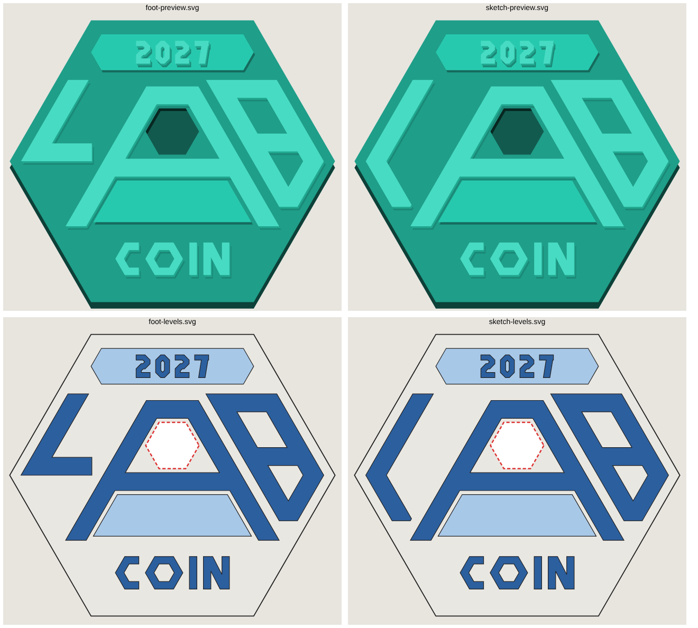

# LabCoin 2027

Скицата, разчертана като вектор в един шестоъгълник (плосък връх, като 2026). Всички наклони са 60° – успоредни на ръбовете на монетата.



Два варианта, разликата е само в L:
- **foot** – L със стъпало (по-лесно се чете като L)
- **sketch** – L като „<“, точно както е в рисунката

## Нива

| Ниво | Какво | Файл |
|---|---|---|
| 0 – основа | целият шестоъгълник (без гнездото за стикер) | `final/<вариант>-0-base.svg` |
| 1 – изпъкнало веднъж | лентата за 2027, трапецът под A | `final/<вариант>-1-level1.svg` |
| 2 – изпъкнало два пъти | L, A, B, COIN, 2027 | `final/<вариант>-2-level2.svg` |
| гнездо | вдлъбнат шестоъгълник за стикер в A | `final/<вариант>-sticker.svg` |

`*-levels.svg` е карта на нивата с цветове. `*-preview.svg` е как изглежда релефът.

CAD файловете са в мм и са с еднакъв viewBox, така че съвпадат един върху друг при внос (Fusion 360, Inkscape). Размерът по подразбиране е 60 мм от връх до връх (стикерът е 9,8 мм). Сменя се с `SIZE_MM` в `final.py`.

## Генериране

```bash
pip install shapely numpy
python3 labcoin-2027/final.py
```

Дебелини, отстояния и размерът на стикера са параметри в началото на `final.py`.
