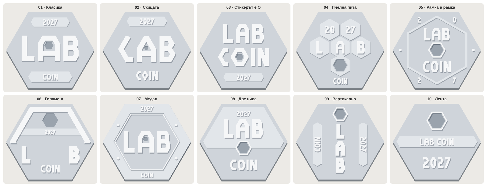

# LabCoin 2027 – разположения

Една и съща монета в 10 различни разположения: шестоъгълник с плосък връх, LAB, COIN, 2027 и гнездо за стикер. Наклоните са 60°, успоредни на ръбовете. Шрифтът идва от скицата: C е половин шестоъгълник, O е шестоъгълник, B е със заострени купи.



| № | Разположение | Идея |
|---|---|---|
| 01 | Класика | Три реда: 2027 горе, голямо LAB в средата, COIN долу. Стикерът е в дупката на A. |
| 02 | Скицата | Разположението от рисунката: L като „<“, A със стикер, B със заострени купи, C – половин шестоъгълник, O – шестоъгълник. |
| 03 | Стикерът е O | LAB и COIN едно под друго като блок. O-то на COIN е шестоъгълник, а стикерът влиза в него. 2027 е в лента долу. |
| 04 | Пчелна пита | Шест клетки като в кошер: 20 | 27 горе, L A B в средата, стикерът в долната. Клетките са изпъкнали веднъж, буквите – два пъти. |
| 05 | Рамка в рамка | Вътрешен шестоъгълник, завъртян на 30°. В ъглите остават 2 0 2 7, вътре LAB, стикерът и COIN. |
| 06 | Голямо A | A е покривът на монетата – следва горните ръбове. Под краката му стоят L и B, стикерът е в A, 2027 е върху чертата му. |
| 07 | Медал | Широк ръб с 2027 горе и COIN долу. В средата голямо LAB, стикерът е в A. |
| 08 | Две нива | Горната половина е една повдигната плоча с 2027 и LAB. Стикерът седи на ръба между двете половини, COIN е долу върху основата. |
| 09 | Вертикално | L, A, B едно под друго в средата. COIN и 2027 текат отстрани. Стикерът е горе, като глава на колона. |
| 10 | Лента | Името на един ред – LAB COIN – върху лента през цялата монета. Стикерът е горе, 2027 е голямо долу. |

## Нива
- **0 основа:** целият шестоъгълник без гнездото за стикер
- **1 изпъкнало веднъж:** ленти, клетки, рамки (по-светлосиво на картинките)
- **2 изпъкнало два пъти:** буквите и цифрите (бяло)
- **стикер:** вдлъбнатото тъмно шестоъгълниче

`layouts/cad/` съдържа по 4 SVG файла за всяко разположение (`-0-base`, `-1-level1`, `-2-level2`, `-sticker`). Те са в мм, с еднакъв viewBox, и се наслагват едно върху друго при внос. Размерът по подразбиране е 60 мм от връх до връх и се сменя чрез `SIZE_MM` в `layouts.py`.

```bash
pip install shapely numpy
python3 labcoin-2027/layouts.py
```
